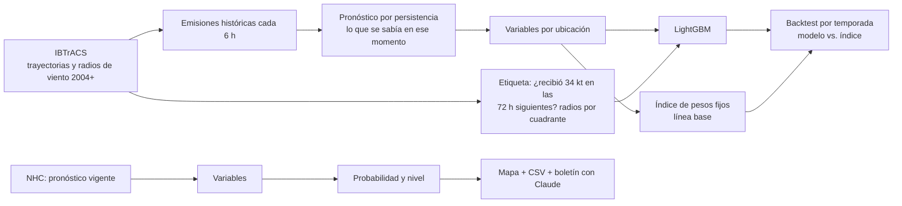

# Riesgo de huracanes por ubicación con IA

Sistema que estima, para cada inmueble de una cartera, la **probabilidad de recibir vientos de tormenta tropical (34 kt o más) en las próximas 72 horas**, a partir del pronóstico del Centro Nacional de Huracanes (NHC). Compara esa probabilidad contra un índice de riesgo de pesos fijos, como el que usan muchos procesos operativos de alertamiento, y redacta un boletín ejecutivo con un LLM (Claude).

Todo funciona con **datos públicos**. Las ubicaciones pueden venir de un CSV propio, del DENUE de INEGI o de una cartera simulada incluida en el proyecto.

## Por qué

Los procesos de alertamiento suelen cruzar el cono del pronóstico con las ubicaciones y asignar un riesgo con reglas fijas: escalones de distancia (menos de 76 km, menos de 176 km…), escalones de viento y pesos definidos a criterio. Funciona, pero:

- Los pesos y cortes nunca se validan contra lo que realmente pasó.
- Los escalones tratan igual una ubicación a 77 km que una a 175 km.
- No distinguen el lado derecho de la trayectoria (el más peligroso en el hemisferio norte) ni el tamaño de la tormenta.

Este proyecto aprende esa relación de huracanes históricos y mide si mejora al índice fijo.

## Cómo funciona



**Etiquetas sin datos privados.** La mejor trayectoria de IBTrACS trae, cada 6 horas, el radio de vientos de 34, 50 y 64 kt en cada cuadrante (NE, SE, SW, NW). Una ubicación "recibió" 34 kt si en alguna hora quedó dentro del radio de su cuadrante. Eso permite entrenar y evaluar con lo que realmente ocurrió.

**Variables por ubicación** (`huracan_ia/variables.py`): distancia actual al centro, distancia mínima al pronóstico y en cuántas horas ocurre, viento actual y pronosticado en ese punto, lado de la trayectoria (−1 izquierda, +1 derecha), margen respecto al cono del NHC, radio de 34 kt de la tormenta, velocidad de traslación y latitud.

**Evaluación honesta.** Se entrena con temporadas anteriores a `--anio-prueba` (2020 por defecto) y se evalúa con las posteriores, para que ninguna tormenta de prueba se filtre al entrenamiento. Se reportan ROC AUC, PR AUC, Brier y, a nivel operativo, cuántas alertas emite cada método, qué porcentaje acierta (precisión) y qué porcentaje de las ubicaciones afectadas detecta (cobertura).

## Uso

```bash
python -m venv .venv && source .venv/bin/activate
pip install -r requirements.txt

python -m huracan_ia descargar                      # IBTrACS Atlántico y Pacífico (~300 MB)
python -m huracan_ia entrenar                       # construye el set, entrena y evalúa
python -m huracan_ia simular --tormenta OTIS --temporada 2023 --emision "2023-10-24 00:00" --boletin
python -m huracan_ia alertar --activas --boletin    # con las tormentas activas del NHC
streamlit run app/streamlit_app.py                  # visor de resultados
```

Con tu propia cartera: `--ubicaciones mis_ubicaciones.csv` (columnas `id, lat, lon` y opcionalmente `nombre, ciudad, estado`; también acepta el CSV del DENUE con `latitud, longitud`).

El boletín con Claude necesita `ANTHROPIC_API_KEY` (ver `.env.example`). Sin ella se genera un boletín de plantilla.

Salidas en `salidas/`: `modelo.joblib`, `metricas.json` y, por cada emisión, `*_alertas.csv`, `*_mapa.html` y `*_boletin.md`.

## Resultados

Corrida del 26 de octubre de 2026 con `python -m huracan_ia entrenar`: IBTrACS v04r01 (Atlántico Norte y Pacífico Oriental, 2004 en adelante), 535 tormentas que pasaron cerca de México y la cartera simulada de 400 ubicaciones. Entrenamiento con temporadas 2004–2019 (777,440 filas) y prueba con 2020 en adelante (379,535 filas de 153 tormentas, 9,092 positivos, 2.4 %). Las cifras salen de `salidas/metricas.json`.

Los umbrales del modelo se calibran sin ver la prueba: se entrena una versión con 2004–2015 y, con las temporadas 2016–2019, se elige la probabilidad con la que el nivel Medio detecta 80 % de las ubicaciones afectadas y el Alto 50 % (`--cobertura-medio`, `--cobertura-alto`). Salieron Medio ≥ 0.018 y Alto ≥ 0.228. Después se reentrena con 2004–2019 y se evalúa en 2020 en adelante.

| Método | ROC AUC | PR AUC | Alertas emitidas | Precisión | Cobertura |
| --- | --- | --- | --- | --- | --- |
| Índice de pesos fijos (nivel Medio o Alto) | 0.824 | 0.230 | 82,877 | 8.4 % | 76.8 % |
| Modelo LightGBM, nivel Medio o Alto (≥ 0.018) | 0.919 | 0.365 | 45,866 | 14.5 % | 73.4 % |
| Modelo LightGBM, solo nivel Alto (≥ 0.228) | 0.919 | 0.365 | 10,223 | 37.2 % | 41.8 % |
| Modelo LightGBM con la misma cobertura que el índice (≥ 0.014, referencia) | 0.919 | 0.365 | 51,923 | 13.4 % | 76.8 % |

Brier del modelo: 0.0195.

**Lectura.** El modelo ordena mejor las ubicaciones que el índice fijo (ROC AUC 0.92 contra 0.82, PR AUC 0.37 contra 0.23). Con los umbrales calibrados emite 45 % menos alertas que el índice y su precisión casi se duplica (14.5 % contra 8.4 %), a cambio de detectar 73 % de las ubicaciones afectadas en vez de 77 %. La cobertura en prueba quedó por debajo del 80 % buscado en validación: las temporadas recientes no se comportan exactamente igual que las de calibración. El nivel Alto es para priorizar: acierta más de un tercio de sus alertas.

Antes de calibrar, el umbral fijo de 0.30 solo detectaba 37 % de las afectadas.

Las variables con más peso (ganancia) son la distancia actual al centro, la velocidad de traslación, el margen respecto al cono y la distancia mínima al pronóstico.

**Backtest de Otis 2023** (`simular --tormenta OTIS --temporada 2023 --emision "2023-10-24 00:00"`, unas 30 horas antes de tocar tierra en Acapulco, cuando aún era tormenta tropical): de las 400 ubicaciones, 26 recibieron 34 kt o más en las 72 h siguientes. El índice fijo alertó 201 y atrapó las 26. El modelo con umbrales calibrados alertó 74 (73 en Medio, 1 en Alto) y también atrapó las 26: un tercio de las alertas del índice con la misma detección. Con el umbral anterior de 0.30 no alertaba ninguna. Solo una ubicación llegó a Alto porque Otis se intensificó de forma explosiva, algo que un pronóstico por persistencia no puede anticipar.

## Limitaciones

- **Umbrales calibrados con otro modelo.** Se eligen con el modelo entrenado hasta 2015 y se aplican al reentrenado hasta 2019, así que la cobertura real puede moverse unos puntos (en prueba fue 73 % contra 80 % buscado).
- **Persistencia vs. pronóstico oficial.** Para entrenar se usa un pronóstico por persistencia (extrapolar las últimas 12 h), porque es lo que se puede reconstruir para cualquier momento histórico. En operación se usa el pronóstico del NHC, que es mejor, así que el modelo probablemente sobrestima la incertidumbre. La siguiente fase es entrenar con el archivo de pronósticos oficiales del NHC.
- **Radio de 34 kt en operación.** El shapefile de puntos del NHC no trae radios de viento; si no se pasa `--r34-km`, se usa la mediana histórica.
- **Viento, no daño.** La etiqueta es haber recibido vientos de 34 kt, no daño ni cierre. Con registros reales de afectaciones se puede entrenar una versión con esa etiqueta.
- **Lluvia y marea de tormenta** no están modeladas.

## Estructura

```
huracan_ia/
  geo.py          distancias y rumbos geodésicos (sin arcpy)
  ibtracs.py      descarga, lectura e interpolación horaria de IBTrACS
  etiquetas.py    viento recibido por ubicación según radios por cuadrante
  pronostico.py   pronóstico por persistencia y lectura del NHC
  variables.py    variables por ubicación
  indice_base.py  índice de pesos fijos (línea base)
  dataset.py      conjunto de entrenamiento histórico
  modelo.py       entrenamiento, evaluación y niveles
  boletin.py      boletín ejecutivo con Claude
  mapa.py         mapa Folium
  ubicaciones.py  cartera simulada o desde CSV/DENUE
app/streamlit_app.py
tests/            pruebas con tormentas sintéticas (pytest)
```

## Fuentes

- [IBTrACS v04r01](https://www.ncei.noaa.gov/products/international-best-track-archive), NOAA/NCEI.
- [NHC GIS](https://www.nhc.noaa.gov/gis/) y [CurrentStorms.json](https://www.nhc.noaa.gov/CurrentStorms.json), NOAA.
- [Cono de pronóstico del NHC](https://www.nhc.noaa.gov/aboutcone.shtml).
- [DENUE](https://www.inegi.org.mx/app/mapa/denue/), INEGI (opcional).
