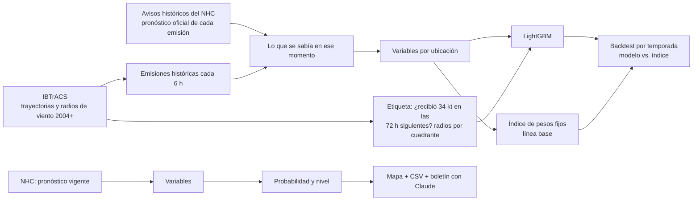

# Riesgo de huracanes por ubicación con IA

Sistema que estima, para cada inmueble de una cartera, la **probabilidad de recibir vientos de tormenta tropical (34 kt o más) en las próximas 72 horas**, a partir del pronóstico del Centro Nacional de Huracanes (NHC). Compara esa probabilidad contra un índice de riesgo de pesos fijos, como el que usan muchos procesos operativos de alertamiento, y redacta un boletín ejecutivo con un LLM (Claude).

Todo funciona con **datos públicos**. Las ubicaciones pueden venir de un CSV propio, del DENUE de INEGI o de una cartera simulada incluida en el proyecto.

## Por qué

Los procesos de alertamiento suelen cruzar el cono del pronóstico con las ubicaciones y asignar un riesgo con reglas fijas: escalones de distancia (menos de 76 km, menos de 176 km…), escalones de viento y pesos definidos a criterio. Funciona, pero:

- Los pesos y cortes nunca se validan contra lo que realmente pasó.
- Los escalones tratan igual una ubicación a 77 km que una a 175 km.
- No distinguen el lado derecho de la trayectoria (el más peligroso en el hemisferio norte) ni el tamaño de la tormenta.

Este proyecto aprende esa relación de huracanes históricos y mide si mejora al índice fijo.

## Cómo funciona



**Etiquetas sin datos privados.** La mejor trayectoria de IBTrACS trae, cada 6 horas, el radio de vientos de 34, 50 y 64 kt en cada cuadrante (NE, SE, SW, NW). Una ubicación "recibió" 34 kt si en alguna hora quedó dentro del radio de su cuadrante. Eso permite entrenar y evaluar con lo que realmente ocurrió.

**Pronóstico oficial histórico.** Cada aviso del NHC (Forecast/Advisory, cada 6 horas) trae la posición, el viento, los radios de 34 kt y el pronóstico oficial a 12, 24, 36, 48, 60 y 72 h. `huracan_ia/nhc_archivo.py` lee esos avisos del [archivo público del NHC](https://www.nhc.noaa.gov/archive/), así el modelo se entrena con la misma información que tendrá en operación. Con `--pronostico persistencia` se puede entrenar en su lugar con una extrapolación de las últimas 12 h.

**Variables por ubicación** (`huracan_ia/variables.py`): distancia actual al centro, distancia mínima al pronóstico y en cuántas horas ocurre, viento actual y pronosticado en ese punto, lado de la trayectoria (−1 izquierda, +1 derecha), margen respecto al cono del NHC, radio de 34 kt de la tormenta, velocidad de traslación y latitud.

**Evaluación honesta.** Se entrena con temporadas anteriores a `--anio-prueba` (2020 por defecto) y se evalúa con las posteriores, para que ninguna tormenta de prueba se filtre al entrenamiento. Se reportan ROC AUC, PR AUC, Brier y, a nivel operativo, cuántas alertas emite cada método, qué porcentaje acierta (precisión) y qué porcentaje de las ubicaciones afectadas detecta (cobertura).

## Uso

```bash
python -m venv .venv && source .venv/bin/activate
pip install -r requirements.txt

python -m huracan_ia descargar                      # IBTrACS Atlántico y Pacífico (~100 MB)
python -m huracan_ia entrenar                       # baja los avisos del NHC (~10,000, con caché), entrena y evalúa
python -m huracan_ia simular --tormenta OTIS --temporada 2023 --emision "2023-10-24 03:00" --boletin
python -m huracan_ia alertar --activas --boletin    # con las tormentas activas del NHC
streamlit run app/streamlit_app.py                  # visor de resultados
```

Con tu propia cartera: `--ubicaciones mis_ubicaciones.csv` (columnas `id, lat, lon` y opcionalmente `nombre, ciudad, estado`; también acepta el CSV del DENUE con `latitud, longitud`).

El boletín con Claude necesita `ANTHROPIC_API_KEY` (ver `.env.example`). Sin ella se genera un boletín de plantilla.

Salidas en `salidas/`: `modelo.joblib`, `metricas.json` y, por cada emisión, `*_alertas.csv`, `*_mapa.html` y `*_boletin.md`.

## Resultados

Corrida del 26 de octubre de 2026 con `python -m huracan_ia entrenar`: IBTrACS v04r01 (Atlántico Norte y Pacífico Oriental, 2004 en adelante), 535 tormentas que pasaron cerca de México, 10,295 avisos oficiales del NHC y la cartera simulada de 400 ubicaciones. Cada fila es una ubicación en un aviso real. Entrenamiento con temporadas 2004–2019 (610,042 filas) y prueba con 2020 en adelante (304,999 filas de 148 tormentas; 8,682 positivos, 2.8 %). Las cifras salen de `salidas/metricas.json`.

Los umbrales se calibran sin ver la prueba: se entrena una versión con 2004–2015 y, con 2016–2019, se elige la probabilidad con la que el nivel Medio detecta 80 % de las ubicaciones afectadas y el Alto 50 % (`--cobertura-medio`, `--cobertura-alto`). Salieron Medio ≥ 0.073 y Alto ≥ 0.408.

El índice de pesos fijos también se calcula con el pronóstico oficial, como en el proceso operativo.

| Método | ROC AUC | PR AUC | Alertas emitidas | Precisión | Cobertura |
| --- | --- | --- | --- | --- | --- |
| Índice de pesos fijos (nivel Medio o Alto) | 0.949 | 0.397 | 69,013 | 12.2 % | 96.7 % |
| Modelo LightGBM, nivel Medio o Alto (≥ 0.073) | 0.972 | 0.515 | 17,147 | 39.0 % | 77.0 % |
| Modelo LightGBM, solo nivel Alto (≥ 0.408) | 0.972 | 0.515 | 8,352 | 54.9 % | 52.8 % |
| Modelo LightGBM con la misma cobertura que el índice (≥ 0.002, referencia) | 0.972 | 0.515 | 48,574 | 17.3 % | 96.7 % |

Brier del modelo: 0.0190.

**Lectura.** El modelo ordena mejor que el índice (PR AUC 0.52 contra 0.40). Con los umbrales calibrados emite una cuarta parte de las alertas del índice y acierta 39 % de ellas en vez de 12 %, pero detecta 77 % de las ubicaciones afectadas en vez de 97 %. Si se le pide la misma cobertura que el índice, emite 30 % menos alertas. El nivel Alto acierta más de la mitad de sus alertas. Qué cobertura buscar es una decisión operativa: se ajusta con `--cobertura-medio`.

**Pronóstico oficial contra persistencia.** Con las mismas emisiones y ubicaciones de prueba, el modelo entrenado con persistencia (extrapolar 12 h) obtiene ROC AUC 0.916 y PR AUC 0.351; con sus umbrales calibrados emite 39,245 alertas con 16.0 % de precisión y 72.4 % de cobertura. Con el pronóstico oficial el mismo modelo emite menos de la mitad de alertas, con más del doble de precisión y más cobertura.

Las variables con más peso (ganancia) son la distancia mínima al pronóstico, la distancia actual al centro, el lado de la trayectoria y la latitud.

**Backtest de Otis 2023** (`simular --tormenta OTIS --temporada 2023 --emision "2023-10-24 03:00"`, el aviso de unas 27 horas antes de tocar tierra en Acapulco, cuando aún era tormenta tropical): de las 400 ubicaciones, 26 recibieron 34 kt o más en las 72 h siguientes. El índice fijo alertó 110 y atrapó las 26. El modelo alertó 29 (14 en Alto, 15 en Medio) y también atrapó las 26: solo 3 falsas alarmas contra 84 del índice. Con el aviso de 6 horas antes (2023-10-23 21:00) el modelo alertó 31 y atrapó las 26, aunque solo 4 en Alto. Ninguno anticipa que Otis llegaría como categoría 5: el pronóstico oficial tampoco lo hizo.

## Limitaciones

- **Umbrales calibrados con otro modelo.** Se eligen con el modelo entrenado hasta 2015 y se aplican al reentrenado hasta 2019, así que la cobertura real puede moverse unos puntos (en prueba fue 73 % contra 80 % buscado).
- **Avisos completos, no intermedios.** Se usan los avisos Forecast/Advisory de cada 6 h; los avisos especiales o intermedios no traen pronóstico completo.
- **Radio de 34 kt en operación.** El shapefile de puntos del NHC no trae radios de viento; si no se pasa `--r34-km`, se usa la mediana histórica.
- **Viento, no daño.** La etiqueta es haber recibido vientos de 34 kt, no daño ni cierre. Con registros reales de afectaciones se puede entrenar una versión con esa etiqueta.
- **Lluvia y marea de tormenta** no están modeladas.

## Estructura

```
huracan_ia/
  geo.py          distancias y rumbos geodésicos (sin arcpy)
  ibtracs.py      descarga, lectura e interpolación horaria de IBTrACS
  etiquetas.py    viento recibido por ubicación según radios por cuadrante
  nhc_archivo.py  avisos históricos del NHC (pronóstico oficial de cada emisión)
  pronostico.py   pronóstico por persistencia y lectura del NHC
  variables.py    variables por ubicación
  indice_base.py  índice de pesos fijos (línea base)
  dataset.py      conjunto de entrenamiento histórico
  modelo.py       entrenamiento, evaluación y niveles
  boletin.py      boletín ejecutivo con Claude
  mapa.py         mapa Folium
  ubicaciones.py  cartera simulada o desde CSV/DENUE
app/streamlit_app.py
tests/            pruebas con tormentas sintéticas (pytest)
```

## Fuentes

- [IBTrACS v04r01](https://www.ncei.noaa.gov/products/international-best-track-archive), NOAA/NCEI.
- [NHC GIS](https://www.nhc.noaa.gov/gis/) y [CurrentStorms.json](https://www.nhc.noaa.gov/CurrentStorms.json), NOAA.
- [Archivo de avisos del NHC](https://www.nhc.noaa.gov/archive/) (Forecast/Advisory, 2004 en adelante), NOAA.
- [Cono de pronóstico del NHC](https://www.nhc.noaa.gov/aboutcone.shtml).
- [DENUE](https://www.inegi.org.mx/app/mapa/denue/), INEGI (opcional).
